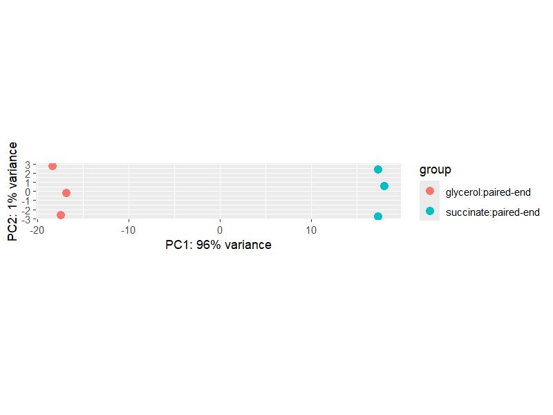
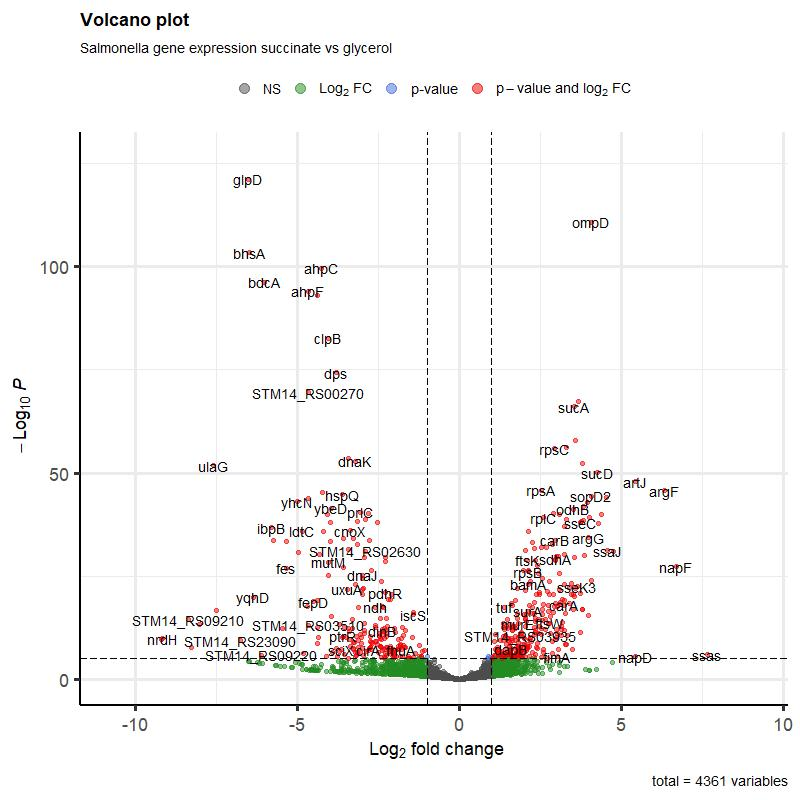
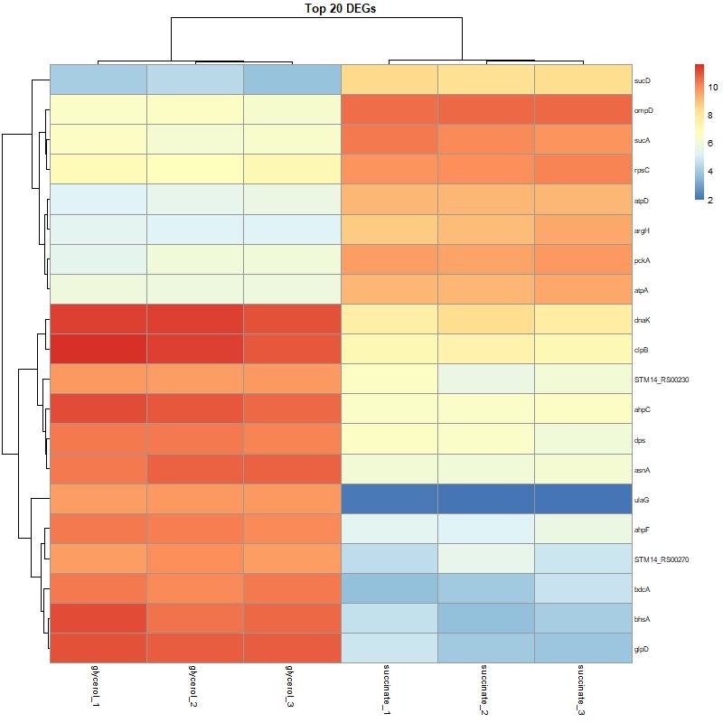
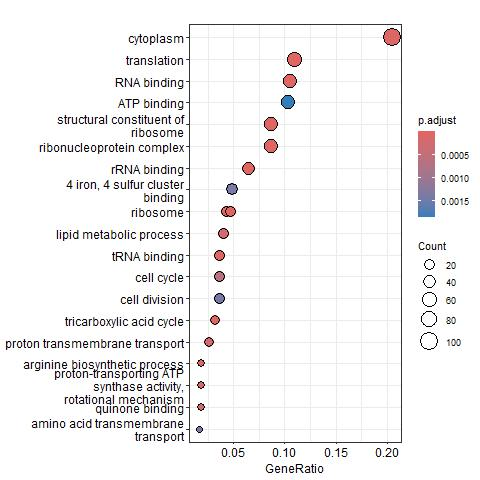

# salmonella-rnaseq-deseq2

[한국어](#한국어) | [English](#english)

| PCA | Volcano plot |
|---|---|
|  |  |

| Top 20 genes | GO terms, up-regulated in succinate |
|---|---|
|  |  |

## 한국어

**작성자:** 홍성민 (*Bioinformatics 2* 수업)

### 프로젝트 소개

*Salmonella* Typhimurium을 **글리세롤(glycerol)** 배지와 **숙신산(succinate)** 배지에서 배양했을 때
유전자 발현이 어떻게 달라지는지 RNA-seq 데이터로 분석한 프로젝트입니다.
조건별 3개씩 총 6개의 paired-end 샘플을 R로 분석했습니다.

*Bioinformatics 2* 수업(2025)의 실습 프로젝트이며, R Markdown 코드는 수업에서 제공한 템플릿을 바탕으로 합니다.

### 분석 과정

**1단계: 전처리 (`preprocessing.sh`, Linux)**

1. `fastq-dump`로 SRA에서 paired-end read 다운로드
2. FastQC와 MultiQC로 원본 read의 품질 확인(QC)
3. Trimmomatic으로 adapter와 품질이 낮은 염기 제거(trimming)
4. Trimming 후 FastQC와 MultiQC로 품질 재확인
5. STAR로 *S.* Typhimurium 14028S 참조 유전체에 mapping하여 BAM 파일 생성
6. `samtools`로 BAM index 생성(IGV 시각화용)

**2단계: 차등 발현 분석 (R Markdown)**

1. `featureCounts`(Rsubread)로 BAM 파일에서 유전자별 read 수 계산
2. 6개 샘플의 read 합계가 10 미만인 유전자 제외
3. DESeq2로 차등 발현 분석, apeglm으로 log2 fold change 보정
4. Count plot, heatmap, volcano plot, MA plot, PCA로 시각화
5. clusterProfiler로 GO 및 regulon over-representation 분석

### 주요 결과

- 필터를 통과한 4,361개 유전자 중, 숙신산 조건에서 **569개가 증가**하고 **525개가 감소**했습니다(adjusted p < 0.01).
- PCA에서 두 조건이 PC1(분산의 96%)을 따라 뚜렷하게 나뉩니다.
- 변화가 가장 유의한 유전자에는 증가한 *ompD*, *sucA*, *sucD*와 감소한 *glpD*, *ahpC*, *dnaK*가 있습니다.
- 증가한 유전자에는 번역(translation), 리보솜, TCA 회로 관련 GO term이 많이 포함되어 있습니다.

### 예상 결과와 실험 결과

예상 결과는 수업 자료의 예시 값과, 원 논문([10.1126/science.aba8026](https://doi.org/10.1126/science.aba8026))을
소개한 수업 자료의 설명을 바탕으로 정리했습니다. LFC는 succinate vs glycerol의 log2 fold change입니다.

| 항목 | 예상 결과 | 실험 결과 | 일치 여부 |
|---|---|---|---|
| 필터 전 유전자 수 | 4,655 | 4,645 | 거의 일치 |
| 필터 후 유전자 수 | 4,370 | 4,361 | 거의 일치 |
| *glpD* | LFC −6.50, 약 90배 감소 | LFC −6.50, 약 90배 감소 (padj 6.9e-122) | 일치 |
| *thrA* | LFC −0.70 | LFC −0.70 | 일치 |
| *yaaA* | LFC −1.23 | LFC −1.23 | 일치 |
| *dcuB* | 숙신산 능동 수송에 관여하므로 증가할 것으로 예상 | LFC 1.7, 약 3.3배 증가 (padj 0.002) | 일치 |
| *ompD* | 유의하게 증가 | LFC 4.07, 약 17배 증가 (padj 1.7e-111) | 일치 |
| STM14_RS19940 | 유의한 변화 없음 | LFC −0.001 (padj 0.997) | 일치 |

### 파일

| 파일 | 내용 |
|---|---|
| `preprocessing.sh` | 다운로드, QC, trimming, mapping 명령어 |
| `Hands-on_session2-3_template_2025.Rmd` | 차등 발현 분석 코드 |
| `counts.csv` | `featureCounts` 결과(유전자 4,645개, 샘플 6개) |
| `genomic.gff` | NCBI RefSeq 유전체 주석, GCF_000022165.1 (ASM2216v1) |
| `GO2gene.tsv`, `go_terms.tsv`, `regulon2gene.tsv` | enrichment 분석용 유전자 세트 |
| `*.jpeg` | 결과 그림 |

BAM 파일은 포함하지 않았습니다. R Markdown 코드는 `preprocessing.sh` 단계의 BAM 파일에서 시작하므로,
BAM 없이 DESeq2 단계부터 실행하려면 `counts.csv`를 `count_table`로 불러와야 합니다.

## English

**Author:** Soungmin Hong (Course *Bioinformatics 2*)

### About

This project uses RNA-seq data to study how gene expression in *Salmonella* Typhimurium differs
between growth on **glycerol** and growth on **succinate**. Six paired-end samples, three per
condition, were analysed in R.

It was a hands-on project for the course *Bioinformatics 2* (2025). The R Markdown file is based
on the template provided by the course.

### Workflow

**Step 1: Preprocessing (`preprocessing.sh`, Linux)**

1. Download the paired-end reads from SRA with `fastq-dump`
2. Check the quality of the raw reads with FastQC and MultiQC
3. Trim adapters and low-quality bases with Trimmomatic
4. Check the quality again after trimming with FastQC and MultiQC
5. Map the reads to the *S.* Typhimurium 14028S reference genome with STAR to get BAM files
6. Index the BAM files with `samtools` for viewing in IGV

**Step 2: Differential expression (R Markdown)**

1. Count reads per gene from BAM files with `featureCounts` (Rsubread)
2. Remove genes with fewer than 10 reads summed over the six samples
3. Test for differential expression with DESeq2 and shrink log2 fold changes with apeglm
4. Visualise with count plots, a heatmap, a volcano plot, an MA plot and PCA
5. Run GO and regulon over-representation analysis with clusterProfiler

### Main results

- Of 4,361 genes that passed the filter, **569 were up-regulated** and **525 down-regulated** in
  succinate (adjusted p < 0.01).
- PCA separates the two conditions clearly along PC1 (96% of the variance).
- The most significant genes include *ompD*, *sucA* and *sucD* (up) and *glpD*, *ahpC* and *dnaK* (down).
- GO terms for translation, the ribosome and the TCA cycle are over-represented among the
  up-regulated genes.

### Expected and observed results

The expected results come from the example values in the course handout and from its description of
the original paper ([10.1126/science.aba8026](https://doi.org/10.1126/science.aba8026)). LFC is the
log2 fold change of succinate vs glycerol.

| Item | Expected | Observed | Agreement |
|---|---|---|---|
| Genes before filtering | 4,655 | 4,645 | Close |
| Genes after filtering | 4,370 | 4,361 | Close |
| *glpD* | LFC −6.50, about 90x lower | LFC −6.50, about 90x lower (padj 6.9e-122) | Yes |
| *thrA* | LFC −0.70 | LFC −0.70 | Yes |
| *yaaA* | LFC −1.23 | LFC −1.23 | Yes |
| *dcuB* | Higher, because it takes part in active succinate transport | LFC 1.7, about 3.3x higher (padj 0.002) | Yes |
| *ompD* | Significantly higher | LFC 4.07, about 17x higher (padj 1.7e-111) | Yes |
| STM14_RS19940 | No significant change | LFC −0.001 (padj 0.997) | Yes |

### Files

| File | Content |
|---|---|
| `preprocessing.sh` | Commands for download, QC, trimming and mapping |
| `Hands-on_session2-3_template_2025.Rmd` | Differential expression code |
| `counts.csv` | `featureCounts` output (4,645 genes, 6 samples) |
| `genomic.gff` | NCBI RefSeq annotation, GCF_000022165.1 (ASM2216v1) |
| `GO2gene.tsv`, `go_terms.tsv`, `regulon2gene.tsv` | Gene sets for enrichment |
| `*.jpeg` | Figures |

The BAM files are not included. The R Markdown code starts from the BAM files of the
`preprocessing.sh` step, so to run it from the DESeq2 step without them, load `counts.csv` as
`count_table`.

## Data source

BioProject [PRJNA578747](https://www.ebi.ac.uk/ena/browser/view/PRJNA578747):
SRR10320667–69 (glycerol), SRR10320670–72 (succinate).
